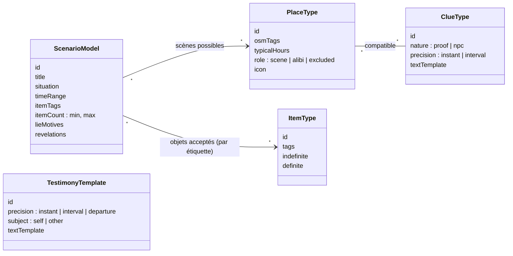
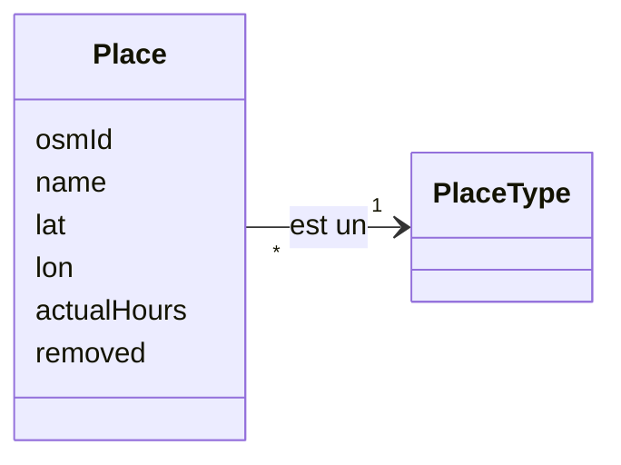
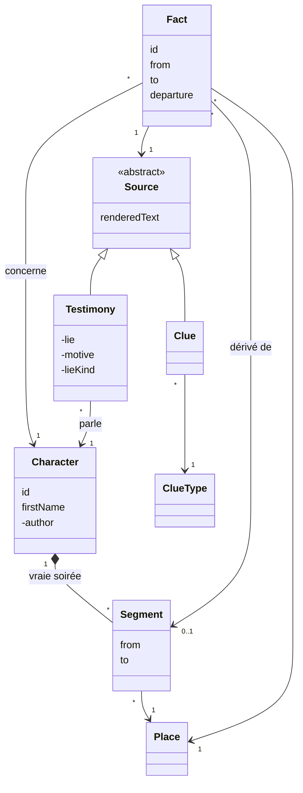
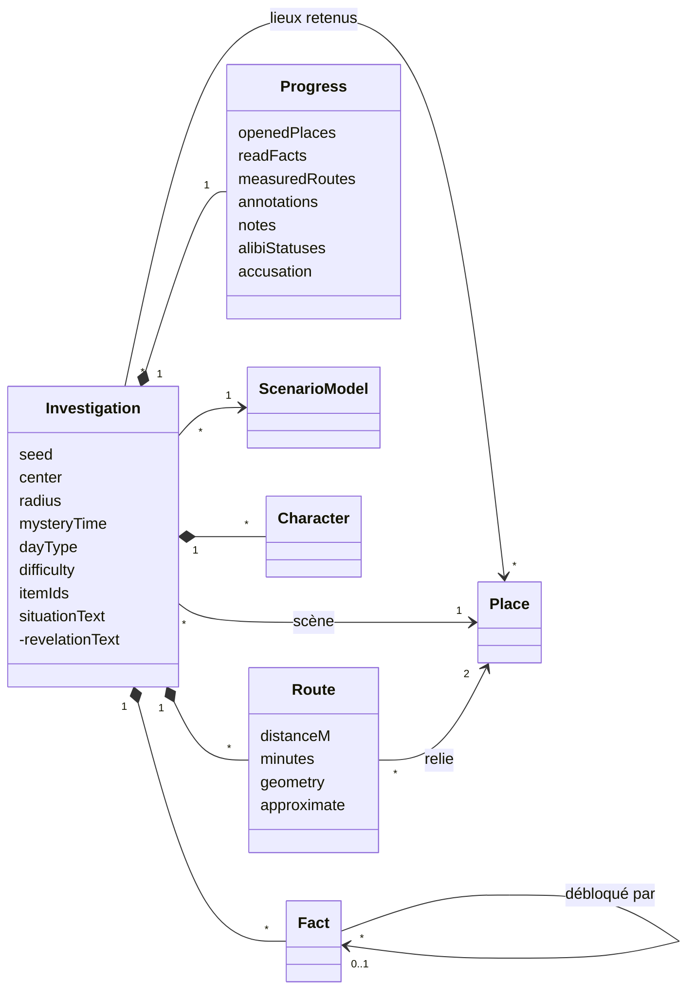

# Modèle de données — référence

> Source unique du modèle. Les briefs y renvoient au lieu de le recopier.
> Les identifiants du modèle (classes, champs, valeurs) sont en anglais ; les textes et explications restent en français.

## 1. Deux couches

| Couche | Contenu | Écrite par | Change quand |
| --- | --- | --- | --- |
| Catalogue | PlaceType, ClueType, compatibilités, ScenarioModel, objets (ItemType), prénoms, gabarits de témoignage | Nous, à la main (fichiers JSON versionnés) | Ajout de contenu |
| Enquête | Lieux retenus, personnages, vraie soirée, faits, trajets, progression | Le générateur, puis le joueur | À chaque nouvelle enquête |

Ajouter une ligne au catalogue enrichit toutes les enquêtes futures sans toucher au code.

**Conventions** : heures en minutes depuis minuit (entiers, ex. 21h05 = 1265) ; distances en mètres entiers ; identifiants en chaînes. L’**heure du mystère** est toujours un multiple de 5 minutes (10h15, 8h05, 18h30 ; jamais 7h57 ni 18h13) ; les autres heures gardent la précision à la minute.

**Horaires** (`typicalHours`, `actualHours`) : `{ weekday, weekend }`, chacun étant une liste d’intervalles `{ from, to }` en minutes depuis minuit, `null` (toujours ouvert : un parc, une fontaine) ou `[]` (fermé toute la journée : une mairie le week-end). Le jour de l’enquête (`dayType`, `weekday` ou `weekend`) choisit la liste qui s’applique. Pour le moment les horaires sont écrits en dur dans le catalogue (`typicalHours`, par type de lieu) pour tester le moteur ; la manière d’obtenir les vrais horaires des vrais lieux sera trouvée plus tard, une fois les lieux réels sur la carte. Le moteur reçoit des horaires déjà prêts et ne lit ni OSM ni `opening_hours`.

## 2. Catalogue

### Rôle des lieux

| Rôle | Exemples | Peut accueillir |
| --- | --- | --- |
| `scene` | Lieux publics non sensibles : parc, fontaine, place, square, rue piétonne, statue, banc, kiosque, marché en plein air ; boulangerie, café, restaurant, pharmacie, boutique, laverie, bibliothèque, arrêt de bus, gare | La farce, ses traces, des PNJ et des témoins ; sert d’alibi dans une enquête dont il n’est pas la scène ; toujours ouvert sans horaires |
| `alibi` | Lieux sensibles : école, lieu de culte, hôpital, cimetière, monument aux morts | Alibi seulement, faits neutres ou positifs ; jamais de farce |
| `excluded` | aire de jeux, habitation | Rien (visible en décor seulement) |

Précisions : un fait placé à la scène (PNJ ou témoin) n’innocente personne : le solveur l’ignore (§7) ; une farce inoffensive ne nuit pas à la réputation d’un lieu public (le droit de retrait `removed` reste là pour qui s’y oppose) ; un lieu sensible n’accueille jamais de farce ; un marché peut être une scène sans jamais nommer un étal.

Dans le catalogue JSON, les scènes possibles d’un `ScenarioModel` sont la liste `sceneTypeIds`, et les compatibilités forment une table « type de lieu → types d’indices ».

### Compatibilités (exemples de départ)

| PlaceType | ClueType compatibles |
| --- | --- |
| boulangerie, pharmacie | ticket de caisse, commerçant témoin |
| café, restaurant | serveur, addition |
| arrêt de bus | chauffeur, titre de transport |
| parc | gardien, joggeur |

### Objets et scénarios composables

Un scénario est une farce générique écrite à la main ; ses détails viennent d’**objets** tirés d’une réserve. Un `ItemType` porte des étiquettes (`wearable`, `linen`, `floating`, `tableware`, `welcome`…) et deux formes écrites avec leur article : indéfinie (« une perruque rose ») et définie (« la perruque »). Un `ScenarioModel` déclare les étiquettes qu’il accepte (`itemTags`) et le nombre d’objets à tirer (`itemCount`, de `min` à `max` ; `0` et `0` pour un scénario sans objet).

Le moteur tire les objets avec la seed, tous différents, et les garde dans l’enquête (`itemIds`). Exemple : « La statue relookée » accepte 1 à 2 objets `wearable`, et donne « la statue porte des lunettes de soleil et une perruque rose » ou « la statue porte du rouge à lèvres éclatant ».

### Genres de mensonge

L’auteur ment de l’une des façons que la difficulté permet (`LieKind`) : les cas évidents d’avant restent ceux de la difficulté facile.

| Genre | Ce qui est faux | Comment le joueur le démasque |
| --- | --- | --- |
| `alibi` | L’auteur dit être ailleurs, ou plus longtemps | Un témoin l’a vu partir : contradiction directe |
| `framing` | L’auteur dit qu’un innocent a quitté son lieu plus tôt qu’en réalité | Un indice ou un témoin innocenté contredit l’auteur : sans lui, on ne sait pas qui ment |
| `closed` | L’auteur dit être dans un lieu fermé à cette heure ce jour-là | Aucun témoin ne le contredit : seuls les horaires du lieu le trahissent |

| Difficulté | Genres permis | Preuves lointaines |
| --- | --- | --- |
| 1 | `alibi` | aucune |
| 2 | `alibi`, `framing` | environ 1 suspect sur 3 |
| 3 | `alibi`, `framing`, `closed` | environ 1 suspect sur 2 |

Le genre est stocké dans le témoignage mensonger (`lieKind`, privé comme `lie` et `motive`). Un genre impossible avec les lieux fournis est remplacé par un autre genre permis.

### Motifs du mensonge

L’auteur ment pour une raison bienveillante, révélée à la fin : `surprise` (farce ou cadeau gardé secret), `modesty` (ne veut pas de mérite), `clumsiness` (maladresse), `misunderstanding` (malentendu) ou `mistake` (erreur de jugement ou de lieu). Le mystère peut être une farce, mais l’explication n’en est pas forcément une. Chaque `ScenarioModel` porte, pour chacun de ses motifs possibles (`lieMotives`), le texte de révélation (`revelations`) affiché à la fin.

### Prénoms et textes

- **Prénoms** : une liste du catalogue, d’au moins 12 prénoms (largement plus que le nombre maximal de suspects). Les suspects en reçoivent des prénoms distincts, tirés avec la seed.
- **Gabarits** : textes à trous du catalogue, avec des variables (`{firstName}`, `{place}`, `{time}`, `{speaker}` pour celui qui témoigne…). `ClueType.textTemplate` pour les indices, `TestimonyTemplate` (selon la précision du fait et son `subject` : le témoin parle de lui-même, `self`, ou d’un autre suspect, `other`) pour les témoignages, `ScenarioModel.situation` pour le mystère.
- **Rendu** : le moteur remplit les gabarits à la génération et stocke le résultat dans `renderedText` de chaque source ; l’interface n’affiche que ce texte. Rendu pur et déterministe.
- **Accords** : les gabarits évitent les accords de genre, pour qu’un prénom n’ait pas besoin de genre (ex. « {firstName} a quitté {place} à {time} », pas « {firstName} est parti(e) »). `{place}` est utilisé tel quel, avec « à », « près de » ou « devant » : un nom réel porte déjà son nom commun (« Statue du Poète »), on n’écrit donc jamais « la statue de {place} ».
- **Objets dans les textes** : la situation liste les objets avec `{items}` (formes indéfinies jointes : « a », « a et b », « a, b et c ») ; une révélation cite au plus un objet avec `{item}` (forme définie du premier objet tiré). Pour se passer de grammaire : un objet n’est jamais sujet d’un verbe (« on y a étendu {items} », pas « {items} sèchent »), jamais juste après « de » ou « à » (le chargement du catalogue le refuse), et aucun pronom ni participe ne s’accorde avec lui.

## 3. Lieux

- `actualHours` est facultatif : quand un lieu en fournit (source à définir plus tard), il remplace `typicalHours`. En test, seuls les horaires typiques du catalogue servent.
- `removed` marque un lieu retiré à la demande de son propriétaire (liste d’exclusion par identifiant OSM).

## 4. Faits, sources et vraie soirée

| Source | Fiabilité | Exemple |
| --- | --- | --- |
| Clue de nature `proof` | Toujours vraie | Ticket de Paul, boulangerie, 21h03 |
| Clue de nature `npc` | Toujours vrai | Le serveur : Inès au café de 20h30 à 21h20 |
| Testimony d’un suspect | Fiable seulement une fois ce suspect innocenté | Inès : départ de Lucie du café à 20h50 |

- Seuls les **suspects** sont des `Character`. Les PNJ n’existent qu’à travers les indices de nature `npc`.
- Les **segments** forment la vraie soirée : cachés au joueur, ils servent à générer les faits et à la révélation finale.
- Tout fait vrai pointe vers un segment ; seul le mensonge de l’auteur ne pointe vers rien.
- Une **preuve lointaine** est une vraie preuve d’un séjour plus ancien, datée de sa fin, trop éloignée de l’heure du mystère pour innocenter (écart au moins égal au trajet vers la scène) : vérifiable mais sans effet sur la déduction. Le tableau `segments` d’un personnage n’est donc pas forcément chronologique (le séjour ancien est ajouté à la fin) ; l’indice d’un séjour est sa position dans le tableau.
- Une **tension apparente** est un séjour ancien « tendu » : la personne le quitte au plus 3 minutes avant le dernier moment possible pour atteindre le séjour suivant (écart au moins égal au trajet, jamais en dessous), et elle témoigne elle-même de son arrivée à ce séjour (instant, à l’heure d’entrée). Les deux faits sont vrais et compatibles mais semblent se contredire, ce qui noie la vraie contradiction ; aucune à la difficulté 1. Aucune règle dédiée : `truths-uncontradicted` garantit qu’il ne s’agit jamais d’une vraie contradiction.
- Le lieu d’un indice est celui du fait qu’il prouve.
- `departure` : la personne était au lieu à cet instant et l’a quitté juste après (fait ponctuel, `from = to`).
- Une **preuve** (indice `proof`) est un fait `departure` daté de la fin du séjour (`from = to` = fin du segment) : un ticket, une addition ou un titre de transport prouve un achat ou un passage après lequel la personne part. Les indices PNJ n’ont pas cette contrainte.
- Les attributs privés (`author`, `lie`, `motive`, `lieKind`) ne sont **jamais** lus par le solveur.
- `renderedText` est visible du joueur pour toutes les sources, y compris le témoignage mensonger : il ne doit rien révéler du mensonge.

## 5. Enquête, trajets et progression

- **Centre et rayon** (`center`, `radius`) : position du joueur ou commune choisie, fixés par la construction de la zone (brief 05), pas par le moteur de génération ; le rayon s’élargit jusqu’à réunir assez de lieux (par défaut au moins 6 lieux utilisables, de rôle `scene` ou `alibi`, dont au moins 2 de rôle `scene`).
- **Objets** (`itemIds`) : les objets tirés pour le scénario, dans l’ordre de la situation ; visibles du joueur.
- **Textes du mystère** : `situationText` (affiché) et `revelationText` (privé, affiché après l’accusation) sont rendus par le moteur à la génération, comme les autres textes.
- **Seed** (`seed`) : régénère l’enquête à l’identique (reprise de partie, reproduction de bug).
- **Difficulté** (`difficulty`) : nombre d’étapes de déduction, de 1 à 3, choisi avant la génération et vérifié par le solveur.
- **Suspects** : `difficulty + 2`, soit 3, 4 ou 5. Chaque étape a besoin d’au moins un innocent de plus (un par tour), plus l’auteur ; les prénoms (≥ 12) suffisent largement.
- **Débloqué par** : un fait sans lien est visible dès le départ ; les autres apparaissent quand le fait qui les débloque est découvert.
- **Trajet** (`Route`, ses deux lieux sont `placeA` et `placeB`) : uniquement entre deux lieux de l’enquête ; calculé à la génération ; vitesse 5 km/h. La matrice est **complète** : un `Route` pour chaque paire de lieux fournis au moteur, symétrique (`temps(A, B) = temps(B, A)`), `minutes ≥ 1`. Le tracé (`geometry`, optionnel) est une suite de points `[lon, lat]` de `placeA` à `placeB`. `approximate` (absent = faux) marque un trajet à vol d’oiseau × 1,3, utilisé quand le réseau piéton ne relie pas deux lieux ; le générateur n’en fonde aucune déduction : une fois la scène choisie, il écarte les lieux dont le trajet vers la scène est approximatif.
- **Progression** (`Progress`, `src/lib/game/progress.ts`) : stockée localement sur l’appareil, avec la graine, la difficulté, la zone et la version des données (jamais de donnée cachée). `openedPlaces` : les faits découverts s’en déduisent (ouvrir un lieu révèle tous ses faits). `readFacts` : les faits dont le joueur a touché la pièce ; seuls ceux-là entrent au Carnet, dans les fiches et sur le curseur horaire. `measuredRoutes` : les paires de lieux dont le joueur a demandé le trajet ; le jeu ne conclut rien pendant la partie (ni incohérence ni verdict d’alibi) : le joueur déduit lui-même, et le Carnet explique la partie une fois l’accusation faite. `alibiStatuses` : à vérifier, douteux ou vérifié, choisi par le joueur seul. Les annotations sont attachées à des lieux ; l’accusation est unique et définitive.

## 6. Règles de cohérence

Garanties par construction, vérifiées à la fin ; une enquête qui en viole une est rejetée.

| Règle | Vérification |
| --- | --- |
| Scène dans un lieu public non sensible | Le lieu de la scène a le rôle `scene` |
| Lieux exclus jamais utilisés | Aucun lieu `excluded` ou `removed` parmi les lieux retenus |
| Indice compatible avec son lieu | Le couple (type du lieu du fait, type de l’indice) est dans les compatibilités |
| Indice pendant les horaires | L’heure du fait tombe dans les horaires du lieu le jour de l’enquête |
| Faits vrais dans les horaires | Tout fait vrai, indice ou témoignage, tombe dans les horaires de son lieu ce jour-là : seul le mensonge peut y échapper |
| Trajets réalistes | Entre deux segments d’un personnage, le temps écoulé couvre le trajet |
| Faits vrais dérivés de la vérité | Tout fait non mensonger est inclus dans un segment |
| Seul l’auteur ment | Tout témoignage mensonger est prononcé par l’auteur |
| Prénoms distincts | Deux personnages d’une enquête n’ont jamais le même prénom |
| Textes complets | Chaque source a un `renderedText` sans variable non résolue |
| Solution unique | Le solveur laisse exactement un suspect possible : l’auteur |
| Matrice complète | Une `Route` existe pour chaque paire de lieux fournis |
| Nombre de suspects | `difficulty + 2` personnages, difficulté de 1 à 3 |
| Déblocage sans cycle | Le graphe « débloqué par » est sans cycle ; toute chaîne finit par un fait visible dès le départ |
| Solution atteignable | Le solveur, appliqué aux seuls faits atteignables depuis les faits visibles au départ, donne le même résultat (un seul suspect, l’auteur) |
| Objets compatibles avec le scénario | Les objets de l’enquête existent, sont tous différents, portent une étiquette acceptée par le scénario, en nombre permis |
| Heure du mystère ronde | L’heure du mystère est un multiple de 5 minutes |
| Preuve datée du départ | Toute preuve est un fait `departure` dont l’heure est la fin du segment qu’elle concerne |
| Mensonge démasquable | Le témoignage mensonger est contredit (§7) par au moins un fait fiable à la fin de la résolution, qui n’est pas de l’auteur, ou son lieu est fermé à l’heure annoncée le jour de l’enquête |
| Vérités jamais contredites | Aucun fait vrai n’est contredit par un fait fiable |

## 7. Algorithme du solveur

Le solveur ne lit que ce que le joueur peut voir.

0. **Atteignables** ← faits sans « débloqué par », puis, à répétition, faits dont le fait qui les débloque est atteignable. Le solveur ne lit que les faits atteignables.
1. **Fiables** ← faits atteignables dont la source est un indice (`proof` ou `npc`).
2. Pour chaque suspect non innocenté : il est **innocenté** s’il existe un fait fiable le concernant, à un lieu `L ≠ scène`, tel que `écart < temps(L, scène)`, avec `écart = max(fait.from − T, T − fait.to, 0)` et `T` l’heure du mystère (`mysteryTime`).
3. Les témoignages des suspects innocentés deviennent **fiables**.
4. Recommencer à l’étape 2 jusqu’à ce que plus rien ne change.
5. **Valide** si exactement un suspect reste possible et que c’est l’auteur. **Difficulté** = nombre de tours au cours desquels au moins un suspect est innocenté. Une difficulté de 2 ou plus signifie qu’il faut s’appuyer sur le témoignage d’un innocent pour en innocenter un autre.

### Contradiction et validation d’un témoignage

Deux faits `A` et `B` sur le même personnage **se contredisent** si :
- ils sont à des lieux différents `L1 ≠ L2` et `écart(A, B) < temps(L1, L2)`, avec `écart(A, B) = max(A.from − B.to, B.from − A.to, 0)` (on n’a pas pu aller de l’un à l’autre) ;
- ou ils sont au même lieu, `A` est un `departure` à l’instant `t` et `B` est un fait de présence avec `B.from ≤ t < B.to` (B affirme une présence continue que le départ interrompt) ;
- ou ils sont au même lieu et tous deux sont des `departure` à des heures différentes (on ne quitte un lieu qu’une fois).

Un témoignage est **contredit** s’il contredit au moins un fait fiable à la fin de la résolution (étape 4), **corroboré** s’il est compatible avec tous les faits fiables et en recoupe un, **non vérifié** sinon. La règle « Mensonge démasquable » exige que le témoignage mensonger soit contredit par un fait fiable, ou démenti par les horaires du lieu ; la règle « Vérités jamais contredites » interdit qu’un fait vrai le soit.

## 8. Exemple de référence (sert de test)

**Lieux** : Café, Boulangerie, Parc (scène). **Trajets** : Café ↔ Parc 12 min, Boulangerie ↔ Parc 4 min, Café ↔ Boulangerie 10 min.
**Mystère** : à 21h05, une boîte à musique enrubannée est déposée sur la fontaine du parc. **Auteur** : Lucie (motif : `surprise`).

| Suspect | Vraie soirée |
| --- | --- |
| Lucie | Café 20h30–20h50, parc 21h02–21h07 |
| Paul | Boulangerie 20h40–21h03 |
| Inès | Café 20h30–21h20 |

| Fait | Source |
| --- | --- |
| Lucie au café 20h30–21h00 | Testimony de Lucie (mensonge) |
| Paul à la boulangerie 20h40–21h03 | Testimony de Paul |
| Inès au café 20h30–21h20 | Testimony d’Inès |
| Lucie quitte le café à 20h50 | Testimony d’Inès |
| Paul quitte la boulangerie à 21h03 | Clue `proof` : ticket de caisse (départ) |
| Inès au café 20h30–21h20 | Clue `npc` : le serveur |

**Résultat attendu** : au tour 1, Paul (écart 2 < 4) et Inès (écart 0 < 12) sont innocentés. Leurs témoignages deviennent fiables ; celui d’Inès place Lucie au café à 20h50, soit un écart de 15 ≥ 12 : il ne l’innocente pas. Le tour 2 ne change rien. Lucie est seule possible : enquête valide, difficulté 1. Pour le joueur, le témoignage d’Inès sert à démasquer le mensonge de Lucie (21h00 annoncé, 20h50 en réalité) : le départ à 20h50 contredit « café 20h30–21h00 » (même lieu, `20h30 ≤ 20h50 < 21h00`), le témoignage de Lucie est donc contredit et le mensonge démasquable.
**Variante sans le ticket** : Paul n’est plus innocenté, deux suspects possibles : enquête rejetée.
