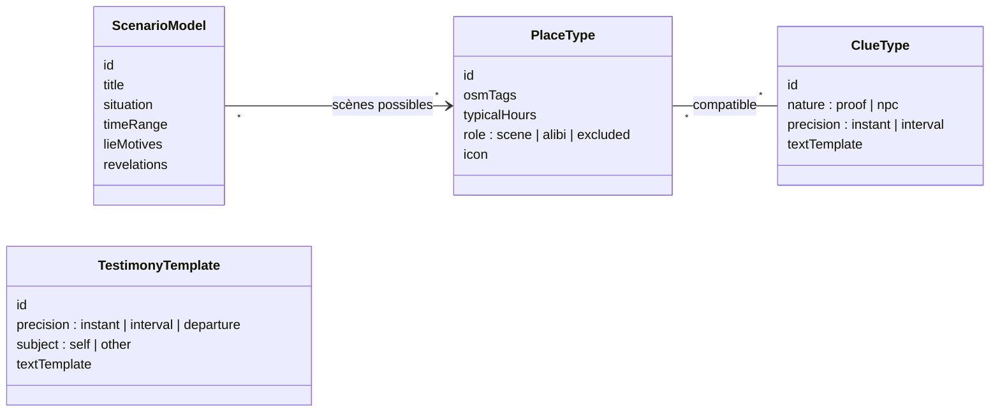
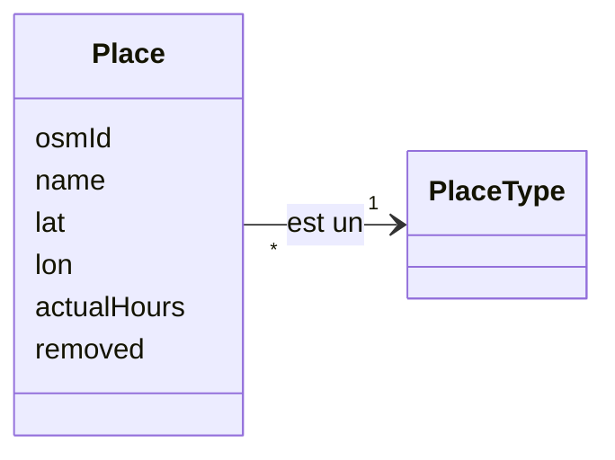
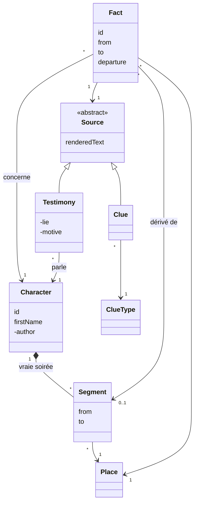

# Modèle de données — référence

> Source unique du modèle. Les briefs y renvoient au lieu de le recopier.
> Les identifiants du modèle (classes, champs, valeurs) sont en anglais ; les textes et explications restent en français.

## 1. Deux couches

| Couche | Contenu | Écrite par | Change quand |
| --- | --- | --- | --- |
| Catalogue | PlaceType, ClueType, compatibilités, ScenarioModel, prénoms, gabarits de témoignage | Nous, à la main (fichiers JSON versionnés) | Ajout de contenu |
| Enquête | Lieux retenus, personnages, vraie soirée, faits, trajets, progression | Le générateur, puis le joueur | À chaque nouvelle enquête |

Ajouter une ligne au catalogue enrichit toutes les enquêtes futures sans toucher au code.

**Conventions** : heures en minutes depuis minuit (entiers, ex. 21h05 = 1265) ; distances en mètres entiers ; identifiants en chaînes.

**Horaires** (`typicalHours`, `actualHours`) : liste d’intervalles `{ from, to }` en minutes depuis minuit, valables tous les jours. Horaires absents = lieu toujours ouvert (cas d’un parc, d’une fontaine). Le parsing de `opening_hours` OSM est hors moteur (brief 02).

## 2. Catalogue

### Rôle des lieux

| Rôle | Exemples | Peut accueillir |
| --- | --- | --- |
| `scene` | Lieux publics non sensibles : parc, fontaine, place, square, rue piétonne, statue, banc, kiosque, marché en plein air ; boulangerie, café, restaurant, pharmacie, boutique, laverie, bibliothèque, arrêt de bus, gare | La farce, ses traces, des PNJ et des témoins ; sert d’alibi dans une enquête dont il n’est pas la scène ; toujours ouvert sans horaires |
| `alibi` | Lieux sensibles : école, lieu de culte, hôpital, cimetière, monument aux morts | Alibi seulement, faits neutres ou positifs ; jamais de farce |
| `excluded` | aire de jeux, habitation | Rien (visible en décor seulement) |

Précisions : un fait placé à la scène (PNJ ou témoin) n’innocente personne : le solveur l’ignore (§7) ; une farce inoffensive ne nuit pas à la réputation d’un lieu public (le droit de retrait `removed` reste là pour qui s’y oppose) ; un lieu sensible n’accueille jamais de farce ; un marché peut être une scène sans jamais nommer un étal.

### Compatibilités (exemples de départ)

| PlaceType | ClueType compatibles |
| --- | --- |
| boulangerie, pharmacie | ticket de caisse, commerçant témoin |
| café, restaurant | serveur, addition |
| arrêt de bus | chauffeur, titre de transport |
| parc | gardien, joggeur |

### Motifs du mensonge

L’auteur ment pour une raison bienveillante, révélée à la fin : `surprise` (farce ou cadeau gardé secret), `modesty` (ne veut pas de mérite), `clumsiness` (maladresse), `misunderstanding` (malentendu) ou `mistake` (erreur de jugement ou de lieu). Le mystère peut être une farce, mais l’explication n’en est pas forcément une. Chaque `ScenarioModel` porte, pour chacun de ses motifs possibles (`lieMotives`), le texte de révélation (`revelations`) affiché à la fin.

### Prénoms et textes

- **Prénoms** : une liste du catalogue, d’au moins 12 prénoms (largement plus que le nombre maximal de suspects). Les suspects en reçoivent des prénoms distincts, tirés avec la seed.
- **Gabarits** : textes à trous du catalogue, avec des variables (`{firstName}`, `{place}`, `{time}`, `{speaker}` pour celui qui témoigne…). `ClueType.textTemplate` pour les indices, `TestimonyTemplate` (selon la précision du fait et son `subject` : le témoin parle de lui-même, `self`, ou d’un autre suspect, `other`) pour les témoignages, `ScenarioModel.situation` pour le mystère.
- **Rendu** : le moteur remplit les gabarits à la génération et stocke le résultat dans `renderedText` de chaque source ; l’interface n’affiche que ce texte. Rendu pur et déterministe.
- **Accords** : les gabarits évitent les accords de genre, pour qu’un prénom n’ait pas besoin de genre (ex. « départ de {firstName} du {place} à {time} », pas « {firstName} est parti(e) »).

## 3. Lieux

- `actualHours` vient du tag OSM `opening_hours` et remplace `typicalHours` quand il existe.
- `removed` marque un lieu retiré à la demande de son propriétaire (liste d’exclusion par identifiant OSM).

## 4. Faits, sources et vraie soirée

| Source | Fiabilité | Exemple |
| --- | --- | --- |
| Clue de nature `proof` | Toujours vraie | Ticket de Paul, boulangerie, 21h03 |
| Clue de nature `npc` | Toujours vrai | Le serveur : Inès au café de 20h30 à 21h20 |
| Testimony d’un suspect | Fiable seulement une fois ce suspect innocenté | Inès : départ de Lucie du café à 20h50 |

- Seuls les **suspects** sont des `Character`. Les PNJ n’existent qu’à travers les indices de nature `npc`.
- Les **segments** forment la vraie soirée : cachés au joueur, ils servent à générer les faits et à la révélation finale.
- Tout fait vrai pointe vers un segment ; seul le mensonge de l’auteur ne pointe vers rien.
- Le lieu d’un indice est celui du fait qu’il prouve.
- `departure` : la personne était au lieu à cet instant et l’a quitté juste après (fait ponctuel, `from = to`).
- Les attributs privés (`author`, `lie`, `motive`) ne sont **jamais** lus par le solveur.
- `renderedText` est visible du joueur pour toutes les sources, y compris le témoignage mensonger : il ne doit rien révéler du mensonge.

## 5. Enquête, trajets et progression

- **Centre et rayon** (`center`, `radius`) : position du joueur ou commune choisie ; le rayon s’élargit jusqu’à réunir assez de lieux (par défaut au moins 6 lieux utilisables, de rôle `scene` ou `alibi`, dont au moins 2 de rôle `scene`).
- **Textes du mystère** : `situationText` (affiché) et `revelationText` (privé, affiché après l’accusation) sont rendus par le moteur à la génération, comme les autres textes.
- **Seed** (`seed`) : régénère l’enquête à l’identique (reprise de partie, reproduction de bug).
- **Difficulté** (`difficulty`) : nombre d’étapes de déduction, de 1 à 3, choisi avant la génération et vérifié par le solveur.
- **Suspects** : `difficulty + 2`, soit 3, 4 ou 5. Chaque étape a besoin d’au moins un innocent de plus (un par tour), plus l’auteur ; les prénoms (≥ 12) suffisent largement.
- **Débloqué par** : un fait sans lien est visible dès le départ ; les autres apparaissent quand le fait qui les débloque est découvert.
- **Trajet** (`Route`) : uniquement entre deux lieux de l’enquête ; calculé à la génération ; vitesse 5 km/h. La matrice est **complète** : un `Route` pour chaque paire de lieux fournis au moteur, symétrique (`temps(A, B) = temps(B, A)`), `minutes ≥ 1`.
- **Progression** (`Progress`) : stockée localement sur l’appareil ; les annotations sont attachées à des lieux.

## 6. Règles de cohérence

Garanties par construction, vérifiées à la fin ; une enquête qui en viole une est rejetée.

| Règle | Vérification |
| --- | --- |
| Scène dans un lieu public non sensible | Le lieu de la scène a le rôle `scene` |
| Lieux exclus jamais utilisés | Aucun lieu `excluded` ou `removed` parmi les lieux retenus |
| Indice compatible avec son lieu | Le couple (type du lieu du fait, type de l’indice) est dans les compatibilités |
| Indice pendant les horaires | L’heure du fait tombe dans les horaires du lieu |
| Trajets réalistes | Entre deux segments d’un personnage, le temps écoulé couvre le trajet |
| Faits vrais dérivés de la vérité | Tout fait non mensonger est inclus dans un segment |
| Seul l’auteur ment | Tout témoignage mensonger est prononcé par l’auteur |
| Prénoms distincts | Deux personnages d’une enquête n’ont jamais le même prénom |
| Textes complets | Chaque source a un `renderedText` sans variable non résolue |
| Solution unique | Le solveur laisse exactement un suspect possible : l’auteur |
| Matrice complète | Une `Route` existe pour chaque paire de lieux fournis |
| Nombre de suspects | `difficulty + 2` personnages, difficulté de 1 à 3 |
| Déblocage sans cycle | Le graphe « débloqué par » est sans cycle ; toute chaîne finit par un fait visible dès le départ |
| Solution atteignable | Le solveur, appliqué aux seuls faits atteignables depuis les faits visibles au départ, donne le même résultat (un seul suspect, l’auteur) |
| Mensonge démasquable | Le témoignage mensonger est contredit (§7) par au moins un fait fiable à la fin de la résolution, qui n’est pas de l’auteur |
| Vérités jamais contredites | Aucun fait vrai n’est contredit par un fait fiable |

## 7. Algorithme du solveur

Le solveur ne lit que ce que le joueur peut voir.

0. **Atteignables** ← faits sans « débloqué par », puis, à répétition, faits dont le fait qui les débloque est atteignable. Le solveur ne lit que les faits atteignables.
1. **Fiables** ← faits atteignables dont la source est un indice (`proof` ou `npc`).
2. Pour chaque suspect non innocenté : il est **innocenté** s’il existe un fait fiable le concernant, à un lieu `L ≠ scène`, tel que `écart < temps(L, scène)`, avec `écart = max(fait.from − T, T − fait.to, 0)` et `T` l’heure du mystère (`mysteryTime`).
3. Les témoignages des suspects innocentés deviennent **fiables**.
4. Recommencer à l’étape 2 jusqu’à ce que plus rien ne change.
5. **Valide** si exactement un suspect reste possible et que c’est l’auteur. **Difficulté** = nombre de tours au cours desquels au moins un suspect est innocenté. Une difficulté de 2 ou plus signifie qu’il faut s’appuyer sur le témoignage d’un innocent pour en innocenter un autre.

### Contradiction et validation d’un témoignage

Deux faits `A` et `B` sur le même personnage **se contredisent** si :
- ils sont à des lieux différents `L1 ≠ L2` et `écart(A, B) < temps(L1, L2)`, avec `écart(A, B) = max(A.from − B.to, B.from − A.to, 0)` (on n’a pas pu aller de l’un à l’autre) ;
- ou ils sont au même lieu, `A` est un `departure` à l’instant `t` et `B` est un fait de présence avec `B.from ≤ t < B.to` (B affirme une présence continue que le départ interrompt).

Un témoignage est **contredit** s’il contredit au moins un fait fiable à la fin de la résolution (étape 4), **corroboré** s’il est compatible avec tous les faits fiables et en recoupe un, **non vérifié** sinon. La règle « Mensonge démasquable » exige que le témoignage mensonger soit contredit ; la règle « Vérités jamais contredites » interdit qu’un fait vrai le soit.

## 8. Exemple de référence (sert de test)

**Lieux** : Café, Boulangerie, Parc (scène). **Trajets** : Café ↔ Parc 12 min, Boulangerie ↔ Parc 4 min, Café ↔ Boulangerie 10 min.
**Mystère** : à 21h05, une boîte à musique enrubannée est déposée sur la fontaine du parc. **Auteur** : Lucie (motif : `surprise`).

| Suspect | Vraie soirée |
| --- | --- |
| Lucie | Café 20h30–20h50, parc 21h02–21h07 |
| Paul | Boulangerie 20h40–21h15 |
| Inès | Café 20h30–21h20 |

| Fait | Source |
| --- | --- |
| Lucie au café 20h30–21h00 | Testimony de Lucie (mensonge) |
| Paul à la boulangerie 20h40–21h15 | Testimony de Paul |
| Inès au café 20h30–21h20 | Testimony d’Inès |
| Lucie quitte le café à 20h50 | Testimony d’Inès |
| Paul à la boulangerie à 21h03 | Clue `proof` : ticket de caisse |
| Inès au café 20h30–21h20 | Clue `npc` : le serveur |

**Résultat attendu** : au tour 1, Paul (écart 2 < 4) et Inès (écart 0 < 12) sont innocentés. Leurs témoignages deviennent fiables ; celui d’Inès place Lucie au café à 20h50, soit un écart de 15 ≥ 12 : il ne l’innocente pas. Le tour 2 ne change rien. Lucie est seule possible : enquête valide, difficulté 1. Pour le joueur, le témoignage d’Inès sert à démasquer le mensonge de Lucie (21h00 annoncé, 20h50 en réalité) : le départ à 20h50 contredit « café 20h30–21h00 » (même lieu, `20h30 ≤ 20h50 < 21h00`), le témoignage de Lucie est donc contredit et le mensonge démasquable.
**Variante sans le ticket** : Paul n’est plus innocenté, deux suspects possibles : enquête rejetée.
