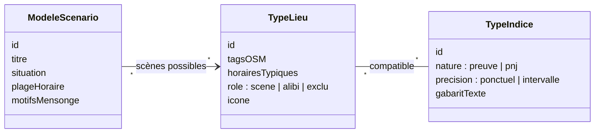
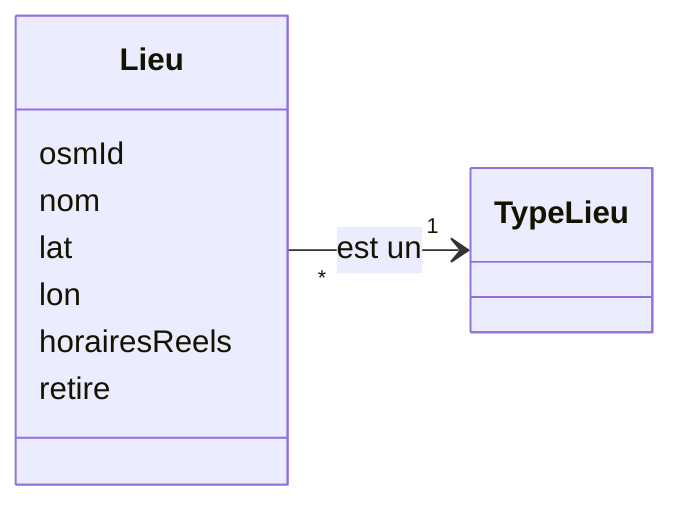
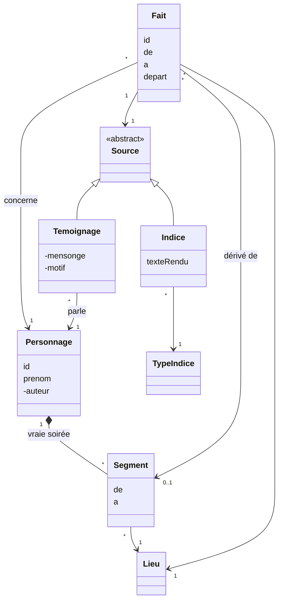
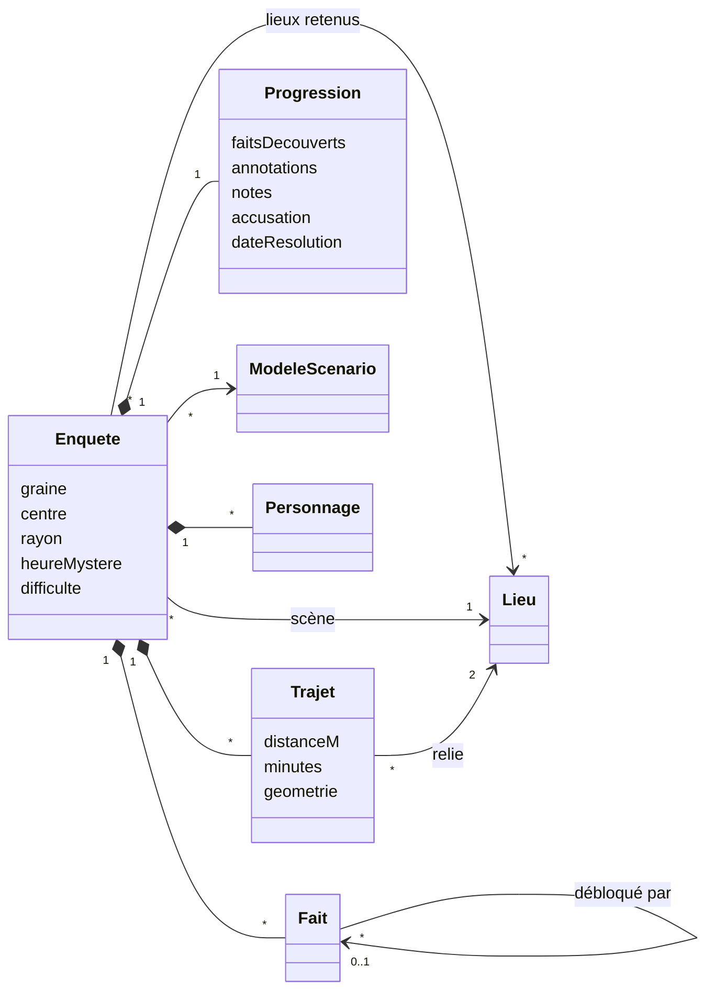

# Modèle de données — référence

> Source unique du modèle. Les briefs y renvoient au lieu de le recopier.

## 1. Deux couches

| Couche | Contenu | Écrite par | Change quand |
| --- | --- | --- | --- |
| Catalogue | TypeLieu, TypeIndice, compatibilités, ModèleScénario | Nous, à la main (fichiers JSON versionnés) | Ajout de contenu |
| Enquête | Lieux retenus, personnages, vraie soirée, faits, trajets, progression | Le générateur, puis le joueur | À chaque nouvelle enquête |

Ajouter une ligne au catalogue enrichit toutes les enquêtes futures sans toucher au code.

**Conventions** : heures en minutes depuis minuit (entiers, ex. 21h05 = 1265) ; distances en mètres entiers ; identifiants en chaînes.

## 2. Catalogue

### Rôle des lieux

| Rôle | Exemples | Peut accueillir |
| --- | --- | --- |
| scene | parc, fontaine, place, square, rue piétonne, statue, banc, kiosque, marché en plein air | Le mystère, ses traces, des PNJ (gardien, joggeur) |
| alibi | boulangerie, café, pharmacie, boutique, arrêt de bus, mairie, bibliothèque, gare | Faits neutres ou positifs uniquement |
| exclu | école, aire de jeux, lieu de culte, hôpital, cimetière, monument aux morts, habitation | Rien (visible en décor seulement) |

Précisions : les établissements publics sont en alibi (un mystère sur place semblerait viser l’institution) ; un marché peut être une scène sans jamais nommer un étal.

### Compatibilités (exemples de départ)

| TypeLieu | TypeIndice compatibles |
| --- | --- |
| boulangerie, pharmacie | ticket de caisse, commerçant témoin |
| café, restaurant | serveur, addition |
| arrêt de bus | chauffeur, titre de transport |
| parc | gardien, joggeur |

### Motifs du mensonge

L’auteur ment pour une bonne raison, révélée à la fin : `surprise`, `modestie` ou `maladresse`.

## 3. Lieux

- `horairesReels` vient du tag OSM `opening_hours` et remplace `horairesTypiques` quand il existe.
- `retire` marque un lieu retiré à la demande de son propriétaire (liste d’exclusion par identifiant OSM).

## 4. Faits, sources et vraie soirée

| Source | Fiabilité | Exemple |
| --- | --- | --- |
| Indice de nature preuve | Toujours vraie | Ticket de Paul, boulangerie, 21h03 |
| Indice de nature PNJ | Toujours vrai | Le serveur : Inès au café de 20h30 à 21h20 |
| Témoignage d’un suspect | Fiable seulement une fois ce suspect innocenté | Inès : Lucie est partie à 20h50 |

- Seuls les **suspects** sont des `Personnage`. Les PNJ n’existent qu’à travers les indices de nature PNJ.
- Les **segments** forment la vraie soirée : cachés au joueur, ils servent à générer les faits et à la révélation finale.
- Tout fait vrai pointe vers un segment ; seul le mensonge de l’auteur ne pointe vers rien.
- Le lieu d’un indice est celui du fait qu’il prouve.
- `depart` : la personne était au lieu à cet instant et l’a quitté juste après (fait ponctuel, `de = a`).
- Les attributs privés (`auteur`, `mensonge`, `motif`) ne sont **jamais** lus par le solveur.

## 5. Enquête, trajets et progression

- **Centre et rayon** : position du joueur ou commune choisie ; le rayon s’élargit jusqu’à réunir assez de lieux (par défaut au moins 2 de rôle scène et 4 de rôle alibi).
- **Graine** : régénère l’enquête à l’identique (reprise de partie, reproduction de bug).
- **Difficulté** : nombre d’étapes de déduction, choisi avant la génération et vérifié par le solveur.
- **Débloqué par** : un fait sans lien est visible dès le départ ; les autres apparaissent quand le fait qui les débloque est découvert.
- **Trajet** : uniquement entre deux lieux de l’enquête ; calculé à la génération ; vitesse 5 km/h.
- **Progression** : stockée localement sur l’appareil ; les annotations sont attachées à des lieux.

## 6. Règles de cohérence

Garanties par construction, vérifiées à la fin ; une enquête qui en viole une est rejetée.

| Règle | Vérification |
| --- | --- |
| Scène dans l’espace public | Le lieu de la scène a le rôle `scene` |
| Lieux exclus jamais utilisés | Aucun lieu `exclu` ou `retire` parmi les lieux retenus |
| Indice compatible avec son lieu | Le couple (type du lieu du fait, type de l’indice) est dans les compatibilités |
| Indice pendant les horaires | L’heure du fait tombe dans les horaires du lieu |
| Trajets réalistes | Entre deux segments d’un personnage, le temps écoulé couvre le trajet |
| Faits vrais dérivés de la vérité | Tout fait non mensonger est inclus dans un segment |
| Seul l’auteur ment | Tout témoignage mensonger est prononcé par l’auteur |
| Solution unique | Le solveur laisse exactement un suspect possible : l’auteur |
| Solution atteignable | Tous les faits nécessaires à la solution peuvent être débloqués |

## 7. Algorithme du solveur

Le solveur ne lit que ce que le joueur peut voir.

1. **Fiables** ← faits dont la source est un indice (preuve ou PNJ).
2. Pour chaque suspect non innocenté : il est **innocenté** s’il existe un fait fiable le concernant, à un lieu `L ≠ scène`, tel que `écart < temps(L, scène)`, avec `écart = max(fait.de − T, T − fait.a, 0)` et `T` l’heure du mystère.
3. Les témoignages des suspects innocentés deviennent **fiables**.
4. Recommencer à l’étape 2 jusqu’à ce que plus rien ne change.
5. **Valide** si exactement un suspect reste possible et que c’est l’auteur. **Difficulté** = nombre de tours au cours desquels au moins un suspect est innocenté. Une difficulté de 2 ou plus signifie qu’il faut s’appuyer sur le témoignage d’un innocent pour en innocenter un autre.

## 8. Exemple de référence (sert de test)

**Lieux** : Café, Boulangerie, Parc (scène). **Trajets** : Café ↔ Parc 12 min, Boulangerie ↔ Parc 4 min, Café ↔ Boulangerie 10 min.
**Mystère** : à 21h05, une boîte à musique enrubannée est déposée sur la fontaine du parc. **Auteur** : Lucie (motif : surprise).

| Suspect | Vraie soirée |
| --- | --- |
| Lucie | Café 20h30–20h50, parc 21h02–21h07 |
| Paul | Boulangerie 20h40–21h15 |
| Inès | Café 20h30–21h20 |

| Fait | Source |
| --- | --- |
| Lucie au café 20h30–21h00 | Témoignage de Lucie (mensonge) |
| Paul à la boulangerie 20h40–21h15 | Témoignage de Paul |
| Inès au café 20h30–21h20 | Témoignage d’Inès |
| Lucie quitte le café à 20h50 | Témoignage d’Inès |
| Paul à la boulangerie à 21h03 | Indice preuve : ticket de caisse |
| Inès au café 20h30–21h20 | Indice PNJ : le serveur |

**Résultat attendu** : au tour 1, Paul (écart 2 < 4) et Inès (écart 0 < 12) sont innocentés. Leurs témoignages deviennent fiables ; celui d’Inès place Lucie au café à 20h50, soit un écart de 15 ≥ 12 : il ne l’innocente pas. Le tour 2 ne change rien. Lucie est seule possible : enquête valide, difficulté 1. Pour le joueur, le témoignage d’Inès sert à démasquer le mensonge de Lucie (21h00 annoncé, 20h50 en réalité).
**Variante sans le ticket** : Paul n’est plus innocenté, deux suspects possibles : enquête rejetée.
