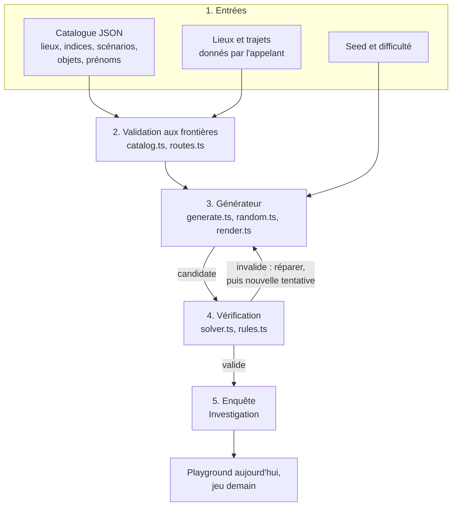
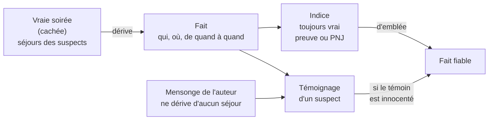

# Le moteur : comment ça marche

Le moteur (`src/lib/engine`) transforme **des lieux, des trajets et un catalogue** en **une enquête que l'on peut résoudre**. Il ne connaît ni l'interface, ni la carte, ni le réseau : c'est du code pur, qui donne le même résultat pour les mêmes entrées.

## Les couches



| Couche | Rôle | Fichiers |
| --- | --- | --- |
| 1. Entrées | Le contenu écrit à la main (`catalog/`), les lieux et la matrice de trajets, la seed et la difficulté | `catalog/*.json`, `types.ts` |
| 2. Validation | Refuse tôt un catalogue ou une matrice incohérents, avec une erreur qui nomme le problème | `catalog.ts`, `routes.ts` |
| 3. Génération | Simule la vérité, en dérive les faits, tire objets et prénoms, rend les textes | `generate.ts`, `random.ts`, `render.ts` |
| 4. Vérification | Résout l'enquête comme un joueur, puis contrôle toutes les règles de cohérence | `solver.ts`, `rules.ts` |
| 5. Enquête | Le résultat : scène, suspects, faits, textes, objets. Les parties cachées au joueur sont à part | `types.ts` |

Rien ne remonte : la génération ne dépend jamais du solveur pour **construire**, seulement pour **contrôler**.

## La vérité d'abord

Le moteur n'écrit jamais une enquête « à l'envers ». Il fait vivre les personnages, puis raconte.

1. **Cadre** : choisit le jour (semaine ou week-end), un scénario, une scène parmi les lieux publics non sensibles ouverts ce jour-là, et l'heure du mystère (multiple de 5 minutes).
2. **Suspects** : `difficulté + 2` prénoms distincts, dont un auteur et un motif de mensonge.
3. **Vraie soirée** : chaque suspect a des séjours enchaînés, compatibles avec les temps de marche. L'auteur est sur la scène à l'heure du mystère.
4. **Faits** : en dérive des indices (preuves datées du départ, PNJ) et des témoignages (voir « Les faits »). Seul l'auteur ment, une fois, de la façon que la difficulté permet (voir « Les genres de mensonge »).
5. **Objets** : tire les objets de la farce (une perruque, un bonnet…) selon le scénario.
6. **Textes** : remplit les gabarits (`renderedText`) pour la situation, la révélation, les indices et les témoignages.
7. **Contrôle** : lance le solveur et les règles. Si l'enquête est invalide, ajoute un indice ; si cela ne suffit pas, recommence avec une seed dérivée (60 tentatives au plus). Sinon renvoie un échec avec sa raison.

## Les faits

Le **fait** est l'unité de base de l'enquête : « telle personne, à tel lieu, entre telle et telle heure ». Le joueur ne voit jamais la vraie soirée, seulement des faits, et il doit deviner lesquels sont fiables.



### Ce qu'un fait contient

| Champ | Sens |
| --- | --- |
| `characterId`, `placeId` | Qui, et où |
| `from`, `to` | De quelle heure à quelle heure, en minutes depuis minuit (`from = to` pour un instant) |
| `departure` | Vrai si la personne était là à cet instant et est partie juste après |
| `segment` | Le séjour de la vraie soirée dont le fait dérive ; vide pour le seul mensonge de l'auteur |
| `unlockedBy` | Le fait qu'il faut découvrir avant de voir celui-ci ; vide = visible dès le départ |
| `source` | Un indice ou un témoignage, avec son texte rendu |

### Les trois sources

| Source | Exemple | Fiabilité |
| --- | --- | --- |
| **Preuve** (indice) | « Ticket de caisse de la boulangerie daté de 21h03 » | Toujours vraie. Datée de la **fin du séjour** (le départ), car on part après avoir acheté ou payé |
| **PNJ** (indice) | « Le serveur : Inès était là de 20h30 à 21h20 » | Toujours vrai, en instant ou en intervalle |
| **Témoignage** d'un suspect | « Inès : Lucie a quitté le café à 20h50 » | Fiable seulement **une fois le témoin innocenté** |

Un témoignage parle de soi (`self`) ou d'un autre suspect (`other`). Le mensonge de l'auteur est un témoignage comme les autres : même gabarit, rien dans le texte ne le trahit.

### Fiable, atteignable, contredit

- **Atteignable** : visible dès le départ, ou débloqué par un fait lui-même atteignable. Le solveur ne lit que les faits atteignables.
- **Fiable** : un indice, ou le témoignage d'un suspect déjà innocenté.
- **Contradiction** : deux faits sur la même personne se contredisent si elle n'a pas pu aller de l'un à l'autre à pied, si un départ interrompt une présence continue au même lieu, ou si elle est dite partir du même lieu à deux heures différentes. Un témoignage est **contredit**, **corroboré** ou **non vérifié** selon les faits fiables.

Exemple (l'exemple de référence du modèle) :

| Fait | Source | Rôle |
| --- | --- | --- |
| Paul quitte la boulangerie à 21h03 | Preuve : ticket de caisse | Innocente Paul : 2 minutes d'écart, 4 minutes de marche |
| Inès au café de 20h30 à 21h20 | PNJ : le serveur | Innocente Inès |
| Lucie au café de 20h30 à 21h00 | Témoignage de Lucie (le mensonge) | Jamais fiable : Lucie n'est jamais innocentée |
| Lucie quitte le café à 20h50 | Témoignage d'Inès | Fiable une fois Inès innocentée ; contredit Lucie (partie à 20h50, pas à 21h00) |

Ce que le joueur retient : le départ d'Inès à 20h50 démasque le mensonge de Lucie, et Lucie, seule suspecte possible, est l'auteur.

## Les genres de mensonge

L'auteur ment une seule fois. Plus la difficulté monte, plus il a de façons de brouiller les pistes :

| Genre | Ce qui est faux | Comment on le démasque | Dès la difficulté |
| --- | --- | --- | --- |
| `alibi` | L'auteur dit être ailleurs ou plus longtemps | Un témoin l'a vu partir : contradiction directe | 1 |
| `framing` | L'auteur dit qu'un innocent est parti plus tôt | Un indice ou un témoin innocenté contredit l'auteur, sans lui on ne sait pas qui ment | 2 |
| `closed` | L'auteur dit être dans un lieu fermé à cette heure | Personne ne le contredit : seuls les horaires du lieu le trahissent | 3 |

À partir de la difficulté 2, certains suspects ont aussi une **preuve lointaine** : un vrai ticket d'un séjour plus ancien, trop loin de l'heure du mystère pour innocenter. Elle est vraie et vérifiable, mais ne sauve personne.

Un tel séjour peut aussi être **tendu** : la personne le quitte tout juste à temps pour arriver au séjour suivant (de 0 à 3 minutes de marge), et elle dit elle-même à quelle heure elle y est arrivée. Les deux faits sont vrais, mais ils *ressemblent* à une contradiction : il faut lire la matrice des trajets pour voir qu'ils sont compatibles. Ces fausses alertes noient la vraie contradiction, qui ne se détache plus d'un coup d'œil.

Les horaires des lieux (semaine et week-end) et le jour de l'enquête s'appliquent à tous les faits vrais dès la difficulté 1 : un fait vrai n'est jamais dans un lieu fermé. Pour le moment les horaires sont écrits en dur dans le catalogue.

## Le solveur

Il ne lit que ce que le joueur peut voir (jamais l'auteur, le mensonge ni le motif).

```text
Un suspect est innocenté s'il existe un fait fiable qui le place ailleurs que
sur la scène, assez près de l'heure du mystère pour qu'il n'ait pas eu le temps
de marcher jusqu'à la scène.

Tour 1 : les indices (preuves, PNJ) innocentent les premiers suspects.
Tour 2 : leurs témoignages deviennent fiables et en innocentent d'autres.
...
Il reste un seul suspect possible : l'auteur.
```

La **difficulté** est le nombre de tours où quelqu'un est innocenté (de 1 à 3). Une difficulté de 2 ou plus oblige à s'appuyer sur le témoignage d'un innocent.

## Les règles de cohérence

Vérifiées sur chaque enquête avant de la livrer (`rules.ts`) :

- **Lieux** : scène de rôle `scene`, aucun lieu exclu ou retiré, matrice de trajets complète, indices compatibles avec leur lieu et ouverts à l'heure du fait.
- **Vérité** : trajets réalistes entre séjours, tout fait vrai appartient à un séjour, preuve datée du départ, heure du mystère ronde.
- **Mensonge** : seul l'auteur ment, une fois ; une source fiable le contredit, ou son lieu est fermé à l'heure annoncée ; aucun fait vrai n'est contredit par un fait fiable.
- **Horaires** : tout fait vrai tombe dans les horaires de son lieu le jour de l'enquête.
- **Déduction** : solution unique, atteignable avec les faits débloqués, liens de déblocage sans cycle.
- **Contenu** : prénoms distincts, textes complets, objets compatibles avec le scénario, `difficulté + 2` suspects.

## Les garanties

- **Déterministe** : même seed, mêmes lieux, même catalogue, même difficulté : même enquête (aucun `Math.random`, horloge ni réseau).
- **Valide ou signalé** : une enquête livrée respecte toutes les règles, sinon la génération retourne `{ ok: false, reason }` (`no-scene` ou `difficulty-unreachable`).
- **Enrichissable sans code** : ajouter une ligne au catalogue (un lieu, un objet, un indice) enrichit toutes les enquêtes.

## Pour l'essayer

`npm run dev`, puis `/playground` : choisir seed, difficulté, scénario et motif, résoudre l'enquête, et voir ce que le moteur a choisi dans l'onglet « Snapshot ».

## Pour aller plus loin

- Le modèle de données, les règles et le solveur en détail : `docs/reference/DATA-MODEL.md`.
- Ce que le moteur garantit, exigence par exigence : `openspec/specs/` (`investigation-generation`, `investigation-solver`, `consistency-rules`, `catalog`, `text-rendering`).
- Le cap et les décisions : `docs/VISION.md`.
